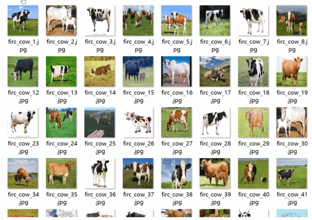
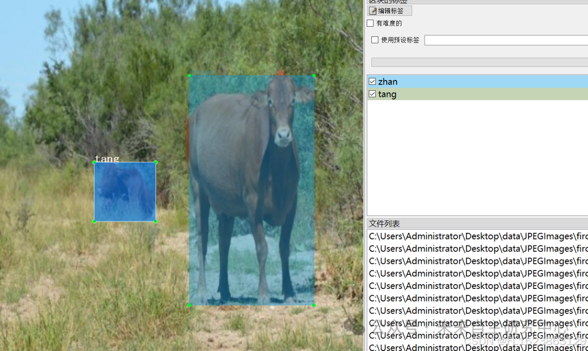

# [Dataset] Object Detection

Dataset format: Pascal VOC format + YOLO format (txt file without split path, only containing jpg images and corresponding VOC format xml files and YOLO format txt files)
Number of images (number of jpg files): 2922
Number of annotations (number of xml files): 2922
Number of annotations (number of txt files): 2922
Number of annotation categories: 4
Annotation category names: ["fangmu", "faqing", "tang", "zhan"]
Number of boxes per category annotation:

| Serial Number || Category Name || Box Count |

1. Fangmu (Shepherding) | 536
2. Faqing (In heat) | 103
3. Tang (Lying Down) | 1581
4. Zhan (Standing) | 1751
Total | 4 | 3971

Using labelImg:

Annotation rules: Rectangular boxes are drawn around categories.
Important note: No specifics available.
Special statement: This dataset does not guarantee the accuracy or precision of models trained on it, nor does it provide accurate and reasonable annotations.
Image preview:

Annotation example:

## Payment

Here is a pay link on Stripe ( https://buy.stripe.com/3cs8yP7sY87d0vu9AB ). Please contact me lonlonago@foxmail.com after funding $89, and I will send you a complete data files , thank you!

